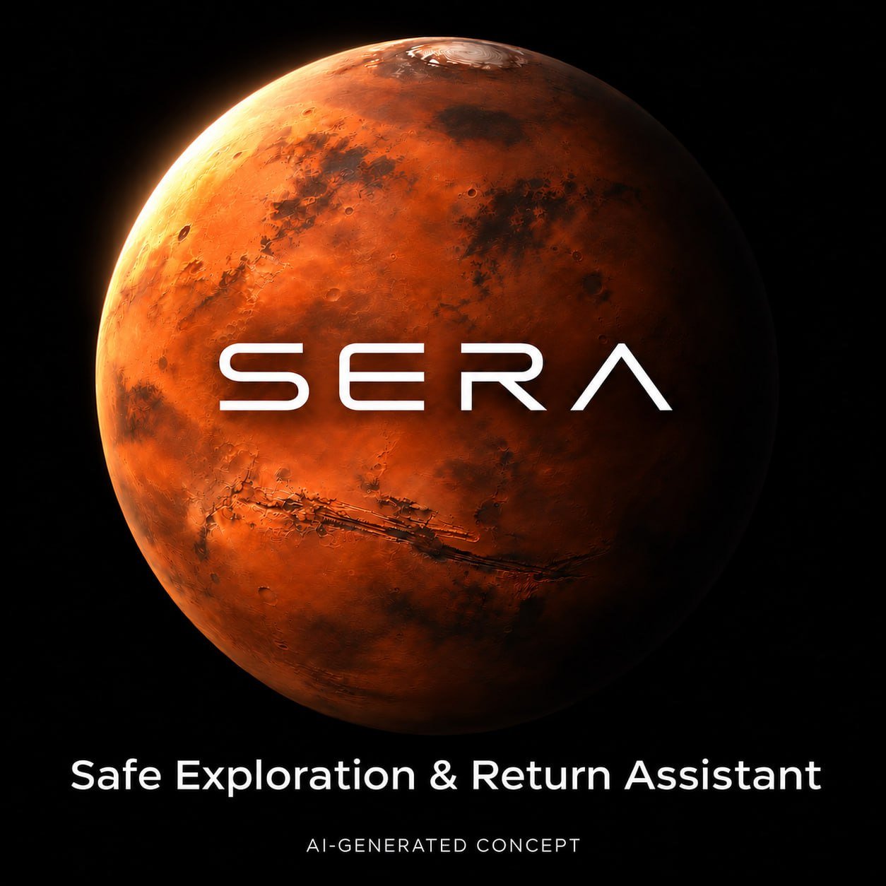

# S.E.R.A — Safe Exploration & Return Assistant



**A walk planner for astronauts on Mars that always knows the way home.**

NASA Space Apps Challenge 2026 · Challenge: *Interplanetary Survival Guide: Martian Map* · Team VAA (Tashkent)

S.E.R.A plans an EVA (a walk outside the habitat) on the real terrain of Gale Crater, where the Curiosity rover works. You place the base and the science points; S.E.R.A finds a safe path over the slopes, picks the fastest order of the points, checks the suit time, daylight and space weather, and answers one question: **can we go out, and will we always get back?** The answer is **GO**, **CAUTION** or **NO-GO**, always with the reason.

> **Live site:** https://isfandiyor-vohidov.github.io/S.E.R.A/ · **Planner:** https://isfandiyor-vohidov.github.io/S.E.R.A/planner.html · **Demo in one click:** https://isfandiyor-vohidov.github.io/S.E.R.A/planner.html?demo=1

## How to use

1. Open the site and press **Launch Mission** — the Mission Planner opens with a ready demo plan.
2. Or open the planner and press **Plan my own EVA**: the first click inside the dashed 2 × 2 km zone places the base, every next click adds a science point. Any marker can be dragged to a new spot; dropped on ground over 25°, outside the zone or with no safe way home, it goes back and S.E.R.A says why. **Clear plan** removes the science points and keeps the base; a second press clears the base too.
3. Press **Start EVA · helmet view** (for the demo plan the button says **Start simulation**) to play the walk as a simulation and try **Emergency · home**. In 3D press **Walk yourself** to leave the route and walk on the terrain (game controls, mouse wheel for third person). On a phone the helmet view is landscape: turn the phone sideways.
4. Read the verdict at the top of the panel. Change the **EVA start time** (**Now** = the current time at the site) or press **Simulate solar storm** to see how the verdict changes.
5. Press **Mission Twin** to compare the fastest and the gentle route to one point. Press the **S.E.R.A** button any time: the assistant explains the current plan.

Only at the very first visit the assistant S.E.R.A shows a short guide: one part of the screen at a time, the rest blurred. Whenever she shows something later (her button, **Show**), the rest of the screen is blurred too; a click on the blur or Esc ends it.

## What it does

| Feature | How |
| --- | --- |
| Map: Mars → Gale Crater → EVA zone | NASA Mars Trek tiles: Viking, CTX, HiRISE |
| Real terrain | 1 m DEM of Gale Crater, cut to a 2 × 2 km zone on a 5 m grid |
| Slopes | 15–25° = caution (time × 2), over 25° = blocked |
| Safe route | A* over the terrain; walking time by Tobler's hiking function × 0.5 for the suit |
| Way home from every point | Reverse Dijkstra from the base; uphill and downhill take different time |
| Fastest order of points | Exact search over all orders up to 8 points, heuristic above |
| Suit budget | 8 h suit, 15 % reserve, 20 min of science work per point |
| Mars clock | Mars24 algorithm: local solar time, season (Ls), sunrise and sunset, Curiosity sol |
| Weather | Curiosity REMS means for the current season |
| Space weather | Live solar particle events (NASA DONKI) and X-ray flares (NOAA GOES) |
| Radio contact | Line of sight from a 10 m mast on the base to the suit antenna over the real terrain (radio shadow on the **Radio** layer); how long the plan stays out of contact. Buddy rule: out of sight of the mast, the buddy relays |
| Move and clear | Drag the base or any point to move it; red while over ground it cannot stand on. **Clear plan** keeps the base |
| Verdict | GO / CAUTION / NO-GO from the worst factor, with the reason |
| Elevation profile and legend | Under the map |
| 3D Mars | A small WebGL globe (no libraries, ~0.5 MB texture) with famous places; Gale Crater opens the EVA zone. On the site and behind the **3D Mars** button of the planner |
| Curiosity path and photos | The real rover path through the zone (144 stops, sols 4464–4989) with Navcam photos; a rover stop can be added as a science point |
| Light and dark theme | Toggle in the top bar, remembered in the browser |
| Helmet view (simulation) | Plays the EVA along the route, first person through a helmet frame: suit time left, time home from where you stand, next target, slope under feet. Speed 1 s = 10 s (walk pace, default in 3D), 1, 4 or 10 min. **Emergency · home** leads back by the fastest safe way from the current spot |
| 3D helmet view | First person on the real terrain of the zone (WebGL, no libraries): the route on the ground, beacons for the points and the base, readouts on the visor glass, a round radar and a compass. Drag to look around. MODEL: 5 m grid, so small rocks are not in the data; the rocks you see are scattered for the look only (never on the route) and the visor says so. The Sun moves with the local solar time. **Map view** switches back to the top-down map. On phones the view is landscape (full screen and turned by itself where the browser allows; otherwise a card asks to turn the phone, **Stay upright** keeps the upright layout) |
| Free walk | In the 3D helmet view, **Walk yourself** lets you leave the route and walk on the terrain. Computer: game controls, the mouse is captured and looks around; **Ctrl** lets the mouse go and captures it again (Esc too); W A S D to walk, Shift to lope, Space to jump; the **mouse wheel** steps out behind the astronaut (third person: a rounded pressure suit with a life-support pack and the gold visor down, knees and elbows bend with the step) and back into the helmet. Phones: a joystick and a jump button. Realistic pace for a pressure suit: walk 1.4 m/s, lope 3 m/s, with inertia (low gravity = little grip: about a second to speed up or stop, no steering in the air), steps sway the head, landings bend the knees, uphill is slower. Mars gravity 0.38 g (3.71 m/s²). Slopes over 25° cannot be climbed, the edge of the EVA zone stops you. **Follow the route** goes back to the planned walk |
| Deviation watch | **Test · off route** moves the walker 40–60 m aside: S.E.R.A builds a new safe path to the next point and keeps the rest of the plan. **Test · storm alert** gives NO-GO and the fastest way home from where you stand |
| Mission Twin | For one science point: Route A (fastest) and Route B (gentle: 15–25° slopes cost 8×), there and back, side by side: distance, steep ground, steepest step, time, spare suit time, and S.E.R.A's recommendation. Both drawn on the map |
| Assistant S.E.R.A | A fictional AI assistant character: first-visit guide, reactions (thinking → GO / CAUTION / NO-GO, welcome back), and an explanation of the current plan on request. She points at what she talks about (a ring and a line in the verdict colour) with a “what to do” line and a fix button; when she shows something, the rest of the screen is blurred. She speaks only when the verdict or its reason changes, and keeps quiet while Mission Twin is open |
| Several EVAs | A plan longer than one suit allows is split into several EVAs from the base, in the same fastest order |
| Minerals (CRISM) | Hydrated minerals and clays from 5 MRO CRISM observations over the zone; the strongest spots (on safe ground) can be added as science points |
| Geology and night IR | USGS global geologic map and THEMIS night infrared (rock vs dust) as map layers |
| Place search | 1,783 IAU named features of Mars, offline, plus our base (“base”, “home”); the map flies there |
| 1-minute tour | `planner.html?tour=1`: globe → zone → demo → verdict → minerals → storm → helmet view |
| Share and print | A link that restores the same plan (`?p=…&t=…`); a printable EVA card |
| Offline | A service worker; **Save offline** downloads the map tiles and photos of the zone (786 files) and can be cancelled |
| Languages | English and Russian (button in the top bar) |

Every number in the app is marked **DATA** (measured by a mission) or **MODEL** (our estimate).

## Verdict rules

| Factor | NO-GO | CAUTION |
| --- | --- | --- |
| Slopes | a point has no path under 25° | part of the route is on 15–25° |
| Suit time | plan is longer than 8 h minus 15 % reserve | less than 30 min spare |
| Daylight | start before sunrise or back after sunset | back less than 1 Mars hour before sunset |
| Space weather | solar particle event in the last 48 h | X-class flare in the last 24 h, or no live data |
| Radio contact | — | more than 15 min in a row out of sight of the base mast |

The radiation dose of the EVA and the dust season are shown for information.

## How we checked it

All numbers below come from one command (no network needed):

```bash
cd tools
node validate.mjs
```

| Check | Result |
| --- | --- |
| Terrain height vs Curiosity's own record at its 144 stops in the zone (sols 4464–4989) | mean difference 0.26 m, max 1.05 m. Rover positions are fitted to orbital maps, so this checks our cut and grid, not the DEM itself |
| Our Mars clock (Ls) vs the Ls in 4,745 REMS daily reports | mean difference 0.77°, max 1.61° (REMS gives whole degrees) |
| Mars clock at Curiosity's landing (2012-08-06 05:17:57 UTC) | sol 0, 15:03 local mean solar time |
| Best order of 6 random points vs trying all 720 orders | 319.51 min, identical; clicking order: 499.94 min |
| Heuristic order (used above 8 points) vs exact, 8 points | 331.63 min vs 331.52 min (0.03 % longer) |
| A* route time vs the Dijkstra field, 13 random pairs | identical (max difference 0.0000 s) |
| Same trip up and down a hill (303 m height difference) | 103.2 min down vs 129.7 min up |
| Walking speed on flat ground | 2.52 km/h (Apollo EVA ≈ 2.2 km/h) |
| Demo plan | 1.93 km, 1 h 56 min, 292 min spare |
| Slopes in the zone | 61.5 % safe, 22.2 % caution, 16.3 % blocked |

## Data sources

| Data | Source | Mission / agency |
| --- | --- | --- |
| Map tiles | [NASA Mars Trek](https://trek.nasa.gov/mars/) WMTS: Viking MDIM 2.1, `Gale_CTX_BlockAdj_dd`, `curiosity_hirise_mosaic` | Viking, MRO CTX, MRO HiRISE |
| Terrain 1 m | [Mars MSL Gale Merged DEM 1m v3](https://astrogeology.usgs.gov/search/map/mars_msl_gale_merged_dem_1m), USGS Astrogeology (Calef & Parker 2016) | MRO HiRISE, MRO CTX, **ESA Mars Express HRSC**, MGS MOLA |
| Curiosity path (zone choice, map layer) | NASA/JPL MMGIS `MSL_waypoints.json`, `MSL_traverse.json` | MSL |
| 3D globe texture | NASA Mars Trek: Viking MDIM 2.1 colour mosaic × MOLA + HRSC shaded relief (`tools/prep_globe.py`) | Viking, MGS MOLA, **ESA Mars Express HRSC** |
| Rover photos | [NASA raw images](https://mars.nasa.gov/msl/multimedia/raw-images/) API, Navcam (linked, not copied) | MSL Navcam |
| Weather | [Curiosity REMS weather feed](https://mars.nasa.gov/rss/api/?feed=weather&category=msl&feedtype=json) | MSL REMS (NASA/JPL-Caltech, CAB) |
| Solar particle events | [NASA DONKI](https://api.nasa.gov/) | NASA CCMC |
| X-ray flares | [NOAA SWPC GOES flare list](https://services.swpc.noaa.gov/json/goes/primary/xray-flares-7-day.json) | NOAA GOES |
| Radiation dose rate | Curiosity RAD, Hassler et al. 2014 | MSL RAD |
| Minerals | CRISM MTRDR browse products (HYD, PHY) from [PDS Geosciences ODE](https://ode.rsl.wustl.edu/mars/) (`tools/prep_crism.py`) | MRO CRISM |
| Geology | USGS SIM 3292 Geologic Map of Mars (Tanaka et al. 2014), via Mars Trek | Viking, MGS, Mars Odyssey, MRO |
| Night infrared | THEMIS night IR controlled mosaic 100 m, via Mars Trek | Mars Odyssey THEMIS |
| Place names | IAU Gazetteer of Planetary Nomenclature, via Mars Trek (`tools/prep_places.py`) | IAU / USGS |

Space agency partner data: ESA Mars Express HRSC is part of the Gale DEM.

## References

- Tobler, W. (1993). *Three presentations on geographical analysis and modeling.* NCGIA Technical Report 93-1 (hiking function).
- Allison, M. & McEwen, M. (2000). A post-Pathfinder evaluation of areocentric solar coordinates. *Planetary and Space Science* 48 — as used in [NASA GISS Mars24](https://www.giss.nasa.gov/tools/mars24/help/algorithm.html).
- Hassler, D. M. et al. (2014). Mars' surface radiation environment measured with the Mars Science Laboratory's Curiosity rover. *Science* 343.
- Calef, F. J. & Parker, T. (2016). MSL Gale Merged Orthophoto Mosaic and DEM. USGS Astrogeology / PDS.
- Horn, B. K. P. (1981). Hill shading and the reflectance map. *Proceedings of the IEEE* 69 (slope method).

## Run it yourself

The site is plain HTML and JavaScript, no build step.

```bash
python -m http.server 8765
```

Then open `http://localhost:8765` (project site) or `http://localhost:8765/planner.html` (Mission Planner).

The data files are already in `data/`. To rebuild them (Node.js 18+):

```bash
cd tools
npm install
node prep_dem.mjs
node prep_rems.mjs
node prep_msl.mjs
python prep_globe.py   # needs Pillow
python prep_crism.py   # needs Pillow
python prep_places.py
python prep_logo.py    # S.E.R.A letters and planet icon cut from our logo
```

`prep_dem.mjs` reads about 130 MB of the 3.6 GB DEM with HTTP range requests.

## Code

| File | Role |
| --- | --- |
| `js/terrain.js` | Elevation grid, slopes, lat/lon ↔ cell |
| `js/pathfinding.js` | Walking time, A*, way-home field |
| `js/planner.js` | Order of points, suit budget |
| `js/marstime.js` | Mars24 clock, Sun |
| `js/risk.js` | GO / CAUTION / NO-GO |
| `js/app.js` | Mission Planner: map, panel, profile, demo (`planner.html`) |
| `js/site.js` | Project site: live demo route on shaded relief (`index.html`) |
| `js/theme.js`, `css/theme.css` | Light and dark theme |
| `js/crism.js` | Minerals layer and spots |
| `js/search.js` | Place search |
| `js/tour.js` | 1-minute tour |
| `js/share.js` | Share link and print card |
| `js/offline.js`, `sw.js` | Offline mode |
| `js/i18n.js` | English / Russian |
| `js/hud.js` | Helmet view: EVA simulation, deviation and storm tests, emergency return, free walk (keys, mouse capture, joystick, Mars gravity) |
| `js/fpv.js` | 3D view of the terrain for the helmet view (WebGL): first and third person, the astronaut model |
| `js/radio.js` | Radio shadow of the base mast and contact gaps along the plan |
| `js/twin.js` | Mission Twin: two routes to one point |
| `js/assistant.js` | Assistant S.E.R.A: guide, reactions, explanation |
| `js/globe.js`, `js/planner-globe.js` | 3D Mars globe |
| `js/curiosity.js` | Curiosity path and photos layer |
| `js/relief.js` | Shaded relief of the terrain grid |
| `js/demo-plan.js` | The demo plan, shared by the site and the planner |
| `tools/prep_dem.mjs`, `tools/prep_rems.mjs`, `tools/prep_msl.mjs` | Data preparation |
| `tools/validate.mjs` | All check numbers of this README |

The core modules are pure functions without the DOM, so they also run in Node.js.

## Use of AI

The code was written with AI assistance (Claude by Anthropic, in Claude Code) and reviewed by the team. Every JavaScript file says so in its header. The idea, the choice of place, the safety rules and all decisions were made by the team; the AI helped to implement them and to check the numbers. The S.E.R.A logo (`img/sera-logo.jpg`) is an AI-generated concept image and is marked so on the image itself. The S.E.R.A character poses (`img/sera/`) and the site picture of S.E.R.A holding Mars (`img/sera-hold.webp`, background removed by us; the planet on her palm is the live 3D Mars from NASA data) and the helmet frame (`img/helmet.webp`) are AI-generated images; S.E.R.A is a fictional character, not a real person, and is marked “AI-generated character” in the app. No voices or videos in this project were made by AI. *(Full report added before submission.)*

## License

Our code: [MIT](LICENSE). Third-party: [Leaflet 1.9.4](https://leafletjs.com/) — BSD-2-Clause (`lib/leaflet/LICENSE`); [geotiff.js](https://github.com/geotiffjs/geotiff.js) (tools only) — MIT. NASA data is public domain; check each source for terms.
